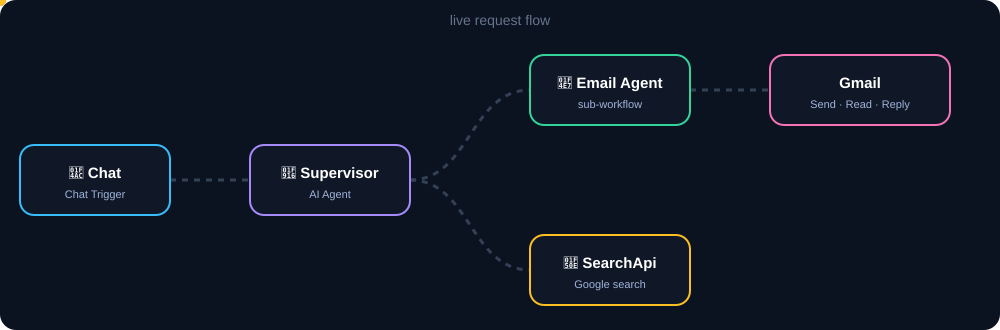
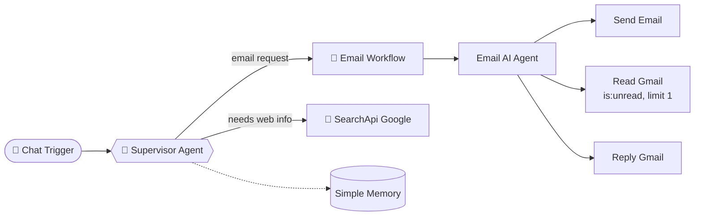

  

  
  
  
  
  

<h3 align="center">A chat assistant that reads, sends and replies to Gmail, and searches the web. It answers in Roman Urdu.</h3>

---

## ✨ What is this?

A two-workflow n8n setup. A **supervisor agent** takes a chat message and picks the right tool:

| You say | The agent does |
|---|---|
| "Mera latest unread email read karo" | 📥 Reads the newest unread Gmail |
| "Us ka reply bhej do" | ↩️ Replies using the message ID, extracted automatically |
| "Ahmed ko email bhejo ke meeting kal hai" | 📤 Writes and sends a new email |
| "Aaj ki taza khabar kya hai?" | 🔎 Searches Google through SearchApi |

## 🎬 Live request flow

  

## 📦 Repository contents

| File | Purpose |
|---|---|
| `Supervisor Agent.json` | Chat entry point, routes requests, replies in Roman Urdu |
| `Email Workflow.json` | Sub-workflow with a Gmail agent (send, read, reply) |

## 🧩 How it works

1. **Chat Trigger** (public) greets the user: *"Hi there! 👋 How can I assist you today?"*
2. The **Supervisor Agent** (AI Agent + Simple Memory) decides which tool to call.
3. **Email requests** go to `Email Workflow`, passing the user's exact query as `query`.
4. The **Email AI Agent** chooses one Gmail tool and returns a confirmation:
   - `Email sent successfully to …`
   - `Successfully read latest unread email from …`
   - `Reply sent successfully to …`
5. For **replies**, the agent takes the message ID from the email data. The user is never asked for it.
6. The supervisor turns the result into a friendly Roman Urdu answer.

<b>🧠 Models used</b>

| Agent | Model |
|---|---|
| Supervisor | OpenRouter `nvidia/nemotron-3-nano-30b-a3b:free` |
| Email Agent | OpenRouter `nvidia/nemotron-3-nano-omni-30b-a3b-reasoning:free` |
| Unused `LLM` node | Google `gemini-2.5-flash` (not connected to anything) |

<b>📜 Agent rules</b>

**Supervisor**
- Never says "I can't check email" or "I can't search the internet".
- Never writes emails or summaries itself; it always delegates.
- Always answers in polite, concise Roman Urdu.

**Email Agent**
- Professional, polite, concise tone.
- Never sends or replies without confirming the recipient.
- Always returns a confirmation message.

## 🚀 Setup

1. **Import** both JSON files in n8n (*Workflows → Import from File*).
2. In the supervisor's **Call 'Email Workflow'** node, re-select the imported `Email Workflow` (workflow IDs are instance-specific).
3. **Add credentials**
   - OpenRouter API
   - Gmail OAuth2 (Send, Read and Reply nodes)
   - SearchApi key
4. **Activate** both workflows (they export as `active: false`).
5. Open the chat URL from the Chat Trigger and say hello 👋

> 💡 `Email Workflow` can be tested on its own. It ships with this pinned input:
> *"Read my latest unread email and reply to it saying that I received the message."*

## ⚠️ Limitations

- `Read Gmail` returns **one** email at a time (latest unread).
- Free OpenRouter models can be rate-limited and unreliable at tool calling.
- The supervisor's tool node has no input mapping defined, while the sub-workflow reads `{{ $json.query }}`. Map `query` explicitly if needed.
- There is no human approval step before sending emails.

## 🛠 Tech stack

`n8n` · `LangChain Agent nodes` · `OpenRouter` · `Gmail API` · `SearchApi`

---

Made with ❤️ and n8n

